# UML 22/09/2026

UNIFIED MODELING LANGUAGE (ha riunificato tutti i modelli che c'erano prima con la collab tra Booch, Jacobson, Rumbaugh che erano tra i creatori di modelli che vedi a fine del pdf 2).
E' uno standard aperto (a modifiche?).
E' stato standardizzato nel '97.

Esistono dei potenti strumenti CASE che possono creare codice a partire da UML e viceversa.

> [!WARNING]
> UML e' un linguaggio, non un METODO! (come quelli a fine pdf 2)
> Puoi usare un metodo scrivendo con UML.

E' descritto con un metamodello? cioe' UML e' autodefinito con del codice UML.

Uml copre tanti fasi del ciclo di vita del codice.

Un diagramma e' una vista di un modello. Il modello di una nave e' una navi piu' piccola un po' semplificata.
I diagrammi ci fanno vedere un modello da un particolare punto di vista.

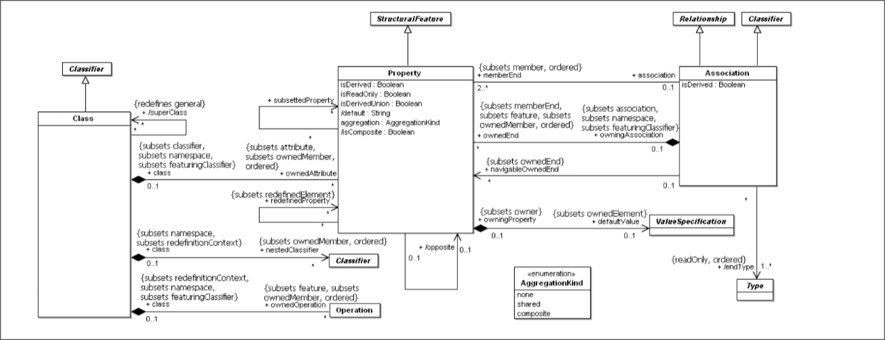

Forse per questa parte conviene di piu' stare sul pdf (tante immagini).
Vabbe' per ora ci provo:

## Entita'

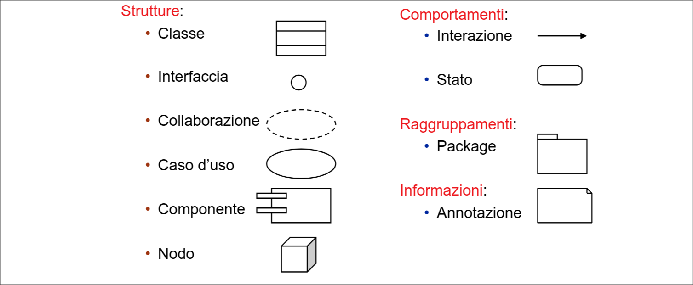

Non useremo mai la Collaborazione (godo).

Un componente e' un modulo (tipo una libreria)
Un nodo e' un dispositivo hardware (server, pc, stampante, ...). Un componente puo' essere messo dentro un nodo per dire che il nodo supporta quel software (del componente).

Comunque le vedremo una ad una...

Dentro ad un package posso mettere tanti elementi del modello che sono correlati (classi che svolgono operazioni simili).
Annotazioni molto utili (anche per rappresentare un vincolo non facilmente esprimibile altrimenti in un linguaggio naturale).

## Relazioni

Legano tra loro le entita'

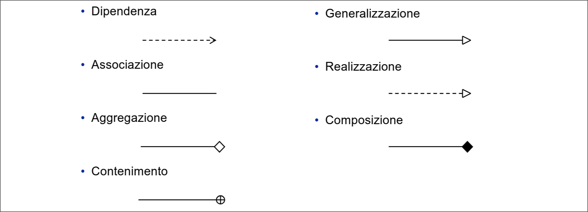

Dipendenza - un entita' A dipende da una B se una modifica in B puo' implicare una modifica in A.
Aggregazione - Part of (debole);
Composizione - Part of (forte);
Realizzazione (NON LA USIAMO NEGLI ESERCIZI)
Contenimento - si usa solo nei diagrammi di package per dire che un package ne contiene degli altri.

## Diagrammi

Sono viste sul modello UML.

### Statici:
* Diagramma delle classi `-` (quelli contrassegnati con questo simbolo possono uscire all'esame)
* Diagramma degli oggetti (compare meno raramente dei diagrammi delle classi)
* Diagramma dei package
* Diagramma dei componenti
* Diagramma di deployment
* Diagramma delle strutture composite

Dinamici:
* Diagramma dei casi d’uso `-`
* Diagramma degli stati `-`
* Diagramma di attività `-`
* Diagramma di interazione
    * Diagramma di sequenza `-`
    * Diagramma di comunicazione
    * Diagramma di sintesi dell’interazione
    * Diagramma dei tempi

# 29/09/2026

# Statici

## Diagramma delle classi

Attraverso questo diagramma si modellano le costituenti fondamentali del nostro sistema.
Classi diagramma di tipo statico.
E' simile all'entity relationship.

### Diagramma degli oggetti

E' una istanza del diagramma delle classi, in effetti non si usa molto ma e' utile per i progettisti per inserire le tuple nel sistema (e' un esempio di come fare).

## Diagramma dei package

Insiemi di classi che collaborano per svolgere una funzionalita' comune

### Diagramma dei componenti

Descrive l'architettura software del sistema

### Diagramma di deployment (schieramento)

Descrive l'architettura hardware del sistema

# Dinamici

## Diagramma dei casi d'uso

Non e' proprio dinamico, elenca le funzionalita' che il sistema puo' svolgere.
Viene creato mettendosi nei panni dell'utente (non di chi progetta il software).

E' il primo diagramma che si disegna quando si inizia la fase di analisi.

## Diagramma degli stati

Facciamo vedere in che modo gli oggetti di una classe reagiscono ad eventi esterni cambiando stato.

## Diagramma di attivita'

Simile al diagramma degli stati. Pero' puo' incorporare anche il diagramma funzionale.
E' perfetto per documentare un workflow.

## Diagrammi di interazione

Sono principalmente funzionali ma c'e' anche una componente dinamica.
Ci fa vedere come gli oggetti interagiscono tra loro scambiandosi messaggi tra loro.
Se A manda un messaggio a B vuol dire che A chiama un metodo di B.

### Diagramma di sequenza

L'unico diagramma di interazione che vedremo.
Enfatizza l'ordine temporale con cui gli oggetti si mandano messaggi.

### Diagramma di comunicazione, ...

Ce ne sono altri di diagrammi di interazione ma non li vedremo.

# Specifiche (p11)

# Ornamenti

Aggiunte che si possono aggiungere alle specifiche (le metteremo senza neanche accorgercene)

# Distinzioni comuni

## Classificatore \ Istanza

(Istanza = oggetto, una specifica cosa; Classificatore = classe, quella cosa in generale)
In uml le Istanze dei classificatori hanno lo stesso nome ma sono sottolineati.

## Interfaccia \ Implementazione

Per un interfaccia devi scrivere `<<interface>>` (e' uno stereotipo).
Ovviamente un interfaccia non ha struttura, non e' istanziabile, e' astratta.
I metodi vanno scritti in corsivo.
Le interfacce possono essere REALIZZATE (freccia tratteggiata vuota)

# MEccanismi di estendibiltia'

## Stereotipo

E' il principale meccanismo di estendibilita' di UML (per estendere le sue funzioni).
Dici praticamente che quell'elemento non e' proprio quello normale del linguaggio ma e' una cosa un po' piu' particolare.
E' una variazione di un elemento di modellazione esistente.
Ce ne sono di predefiniti (tipo <\<interface>>).
Il programmatore puo' introdurne di nuovi.

## Proprieta'

Associa ad un elemento del modello un valore, una stringa.

## Vincoli

Definisce una regola a un elemento del modello
Ad esempio nelle gerarchie ER potrei avere {disjoint, complete}

## Profilo

Un progettista puo' creare un set di stereotipi, proprieta' e vincoli per personalizzare l'UML a piacere.
Esistono dei profili predefiniti standard.

# Architetture

Sono viste diverse che si possono rappresentare sul nostro modello (non molto importante).
Noi lavoreremo sempre a vista dei casi d'uso e vista logica.

FORZA INIZIAMO!

# DIAGRAMMA DEI CASI D'USO

Diagramma funzionale che mostra come gli utenti usano il sistema attraverso casi d'uso (funzionalita').
Gli utenti possono essere altre persone, organizzazioni o anche altri sistemi software.
Comprensibile a chiunque. Infatti serve anche a comunicare con il cliente (non tecnico).
Questo diagramma continua ad essere importante per tutto il ciclo di vita del software. Ad esempio dopo l'implementazione c'e' la fase di test (collaudo) che viene fatta guardando i casi d'uso e si verifica che funzionino. Puo' essere anche usato oer guidare il `rilascio incrementale` del software (a volte il software viene rilasciato a pezzi, "il prossimo mese ti rilascio questi nuovi casi d'uso")

## Attore vs Casi d'uso

Ad esempio per il sistema di Alma esami noi studenti siamo `Attori`.
L'attore scambia informazioni con il sistema, noi ci scriviamo agli appelli e possiamo consultare gli appelli.
L'attore ATTIVA un caso d'uso (iscrizione ad un esame).
L'attore e' sempre una classe, non un oggetto (no istanze).

Il caso d'uso e' sempre attivato da un attore.
Il caso d'uso e' una funzionalita' come percepita da un attore.

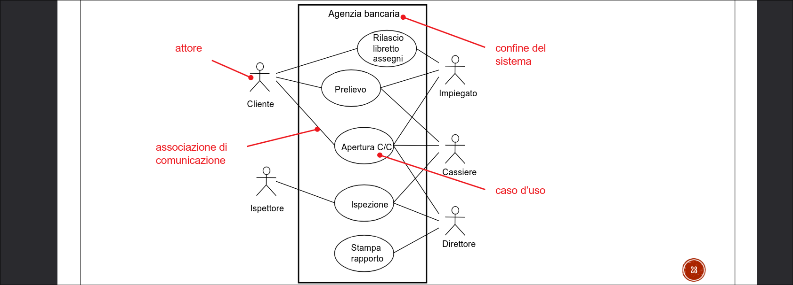

Gli omini sono gli autori.
Le linee nere sono dal punto di vista sintattico delle ASSOCIAZIONI. In particolare sono delle ASSOCIAZIONI DI COMUNICAZIONE, l'attore comunica con il caso d'uso.

I casi d'uso sono i cerchi.
L'attore dal punto di vista sintattico e' un

## Relazioni nei diagrammi di casi d'uso

In questi diagrammi si possono anche disegnare relazioni aggiuntive.

* Puo' esserci generalizzazione tra attori (come nelle ER (gerarchie)).
* Le comunicazioni unidirezionali (da non abusare, normalmente sono bidirezionali) si fanno con una freccia ad esempio stampa rapporto
* Generalizzazione tra casi d'uso: Alcune operazioni sono anche altre operazioni (is a).

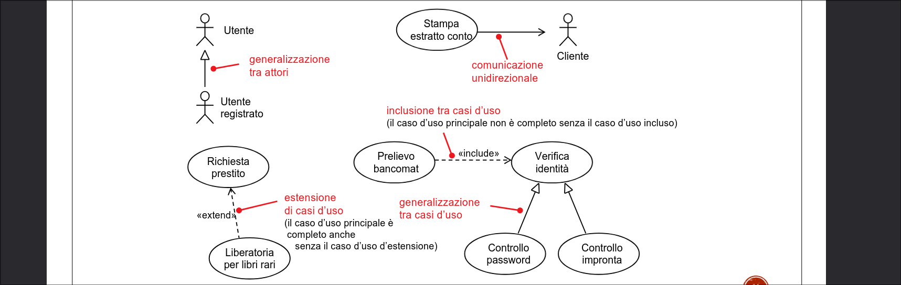

Le dipendenze vanno quasi sempre stereotipate, cosi' spieghi come viene fatta
Ad esempio Prelievo bancomat si puo' fare solo se fai anche la verifica di identita'. Quando sto prelevando mi viene anche verificata l'identita'. La `<<include>>` serve proprio a questo. Devi immaginarti che nella procedura prelievoBancomat() c'e' anche una chiamata a verificaIdentita().
Per le chiamate opzionali si usa la relazione di dipendenza con stereotipo `<<extend>>`. Significa che il caso d'uso principale non sempre chiama quello che estende. Anche in questo caso si puo' vedere come una chiamata di procedura ma che e' opzionale.
La liberatoria per libri rari e' un'estensione per la richiesta prestito (va letta al contrario).

## Come disegnarli

* Prima identifico i confini del sistema (magari non comprende tutto il dominio)

* Poi si inizia disegnando gli attori.

* Per ogni attore ci si chiede come interagisce col sistema e si disegnano i loro casi d'uso.

Poi ci sarebbero anche queste fasi:

* Noi non lo faremo ma nel mondo reale insieme al diagramma dei casi d'uso bisogna fare anche gli `scenari` che non sono altro che istanze dei casi d'uso. Bisogna documentare gli scenari di successo (vado in banca e prelievo) e di insuccesso (vado in banca, ho dimenticato il documento e non posso prelevare) che fanno fallire il caso d'uso. Questa parte non e' modellata da UML ma esisterebbero i diagrammi di attivita' o sequenza ma sticazzi.

* Per ogni caso d'uso poi dovrei fare una mini tabella con descrizioni, attori che coinvogle (primari (attivano il caso d'uso) e secondari), precondizioni (per registrarmi ad un appello devo avere eseguito l'accesso su almaesami), postcondizioni (dopo l'iscrizione sono effettivamente iscritto all'appello, appaio nella lista), sequenza degli eventi

### Realizzazione dei casi d'uso

Come prima con la interfaccia 

Ora stiamo facendo un paio di esercizi sui casi d'uso.
Esercizio negozio articoli per la casa. Evidenziamo gli aspetti statici, dinamici o funzionali nel testo.

Ecco gli esercizi:

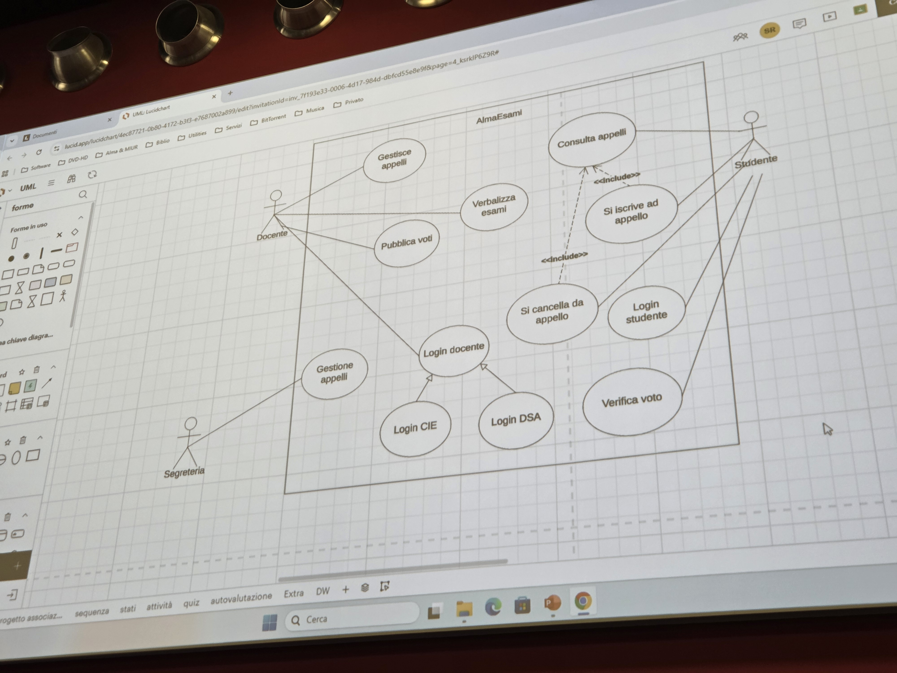

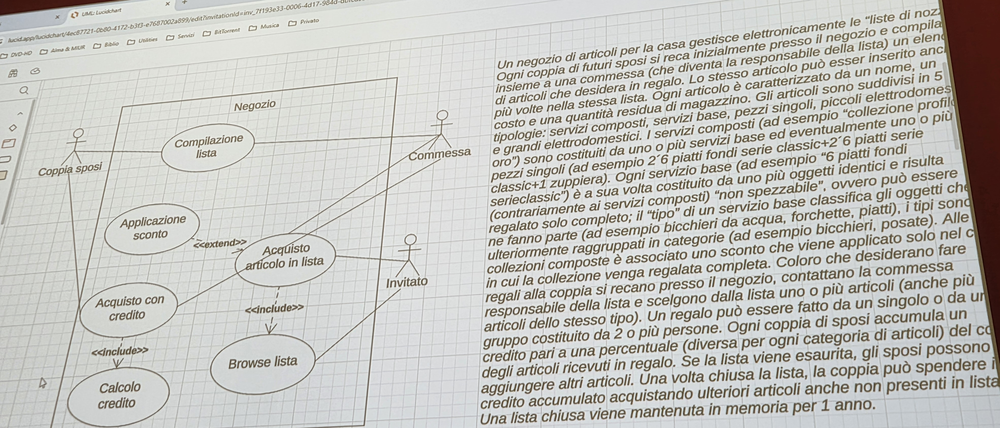

# 02/10/2026

Oggi vediamo

## Diagramma delle classi

p.38 (19 nel pdf).

Ce ne sono di due tipi: 
* diagramma delle classi di analisi (alto livello)
* diagramma delle classi di progettazione (livello piu' preciso, devo prendere delle decisioni per avvicinarmi all'implementazione)

Per molti versi e' piu' importante del diagramma dei casi d'uso.
Puramente statico (un po' come l'ER di database).
Descrive la `struttura` del dominio applicativo (no aspetti dinamici).

Come abbiamo gia' detto le specifiche statiche tendono ad essere gli stessi nel tempo.
Quindi un software che si basa su un diagramma delle classi solitamente vive di piu'

Come abbiamo gia' detto le specifiche statiche tendono ad essere gli stessi nel tempo.
Quindi un software che si basa su un diagramma delle classi solitamente vive di piu'.

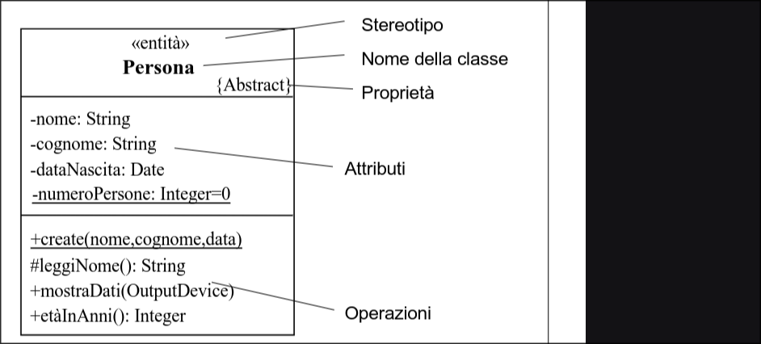

In questo caso ho dichiarato persona come astratto perche' sotto e' sottointesa una gerarchia "is a", quindi la classe astratta ha senso per le gerarchie "is a" (nota che non posso mai istanziare una classe astratta, solo le sue sottoclassi).

> [!NOTE]
> E' comodo (avere entita' astratte estendibili per gerarchia) grazie al polimorfismo e al late binding.

### Attributi

* Visibilita':
    * pubblica `+`
    * privata `-`
    * protetta `#`
    * package `~`
* Molteplicità
    * per esempio: String \[5], Real \[2..*], Boolean \[0..1]
* Tipo
    * Integer, UnlimitedNatural, Real
    * Boolean
    * String
* Ambito
    * istanza
    * classe (attributi che in java si chiamano `static`, valgono per tutti gli oggetti) (nella notazione viene sottolineato)

### Operazioni

_`visibilita'` nome (parametro, ...): tipoRestituito_
            ^                                    ^
            |             signature              |

Stesso nome ma con input diversi: overloading

---

Le classi si possono fare vedere con diversi livelli di dettaglio.

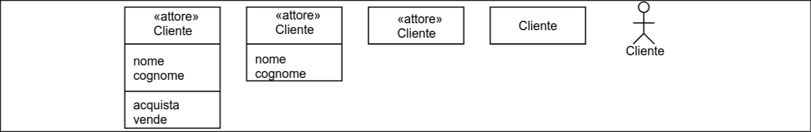

### Relazioni tra le classi

Ci sono diversi modi per collegare tra loro le classi.

#### Associazioni

Astrazione per associazione: mostrare in che modo sono collegati tra loro oggetti di due classi diverse.
Sono quasi sempre bidirezionali (non ci sono freccie quindi, una linea solida e basta).

Devi mettere le molteplicita' come nelle ER (cardinalita' minima e massima).

Molteplicita'

* Esattamente 1:        `1`
* Opzionale 1:          `0..1`
* Da x a y inclusi:     `x..y`
* Solo i valori a,b,c:  `a,b,c`
* 1 o più:              `1..*`
* 0 o più:              `*`

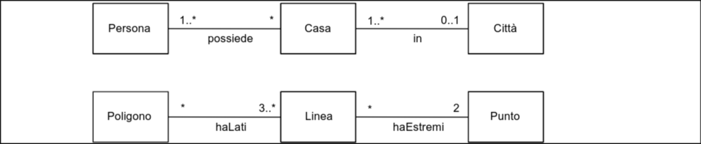

Si legge: "una persona possiede 0 o piu' case", "una casa e' posseduta da 1 o piu' persone"

Le associazioni devono avere un nome che ne esprima la semantica (il significato).

Si possono aggiungere delle freccie per indicare il verso di lettura (utili anche nelle unarie (vedi dirige)):
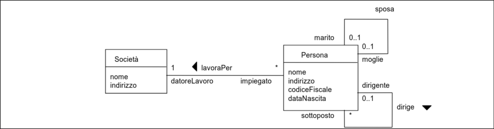
E' un abbellimento in piu' per leggere meglio il grafico. Ben accettate se scritte bene (freccia nera).
Quando implementerai quindi dovrai creare una classe Persona e una classe Societa' e poi per implementare lavoraPer lo faccio per delegazione:
Nella classe Societa' posso avere un attributo impiegati che ha i riferimenti alle Persone impiegati.

Poi c'e' anche questa che serve SOLO PER I DIAGRAMMI DELLE CLASSI DI PROGETTAZIONE (NON DI ANALISI (TROPPO SPECIFICI))

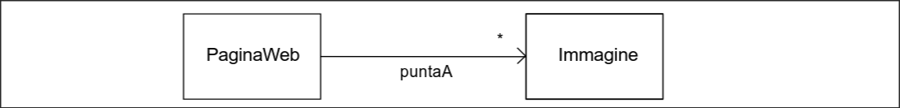

#### E' possibile specificare vincoli e classi associative:

* 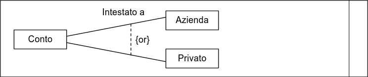
    O e' una o l'altra.

* 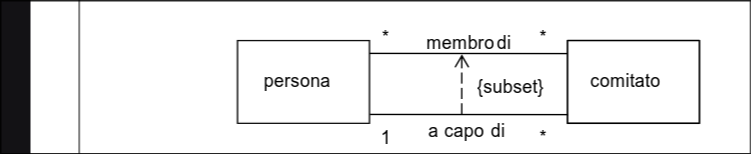
    Un comitato ha tanti membri, una persona puo' essere membra di piu' comitati.
    A capo di un comitato c'e' solo una persona. Una persona puo' essere capo di piu' comitati.
    La freccia mi dice che le istanze dell'associazione (l'accoppiata degli OID che partecipano alla associazione) "a capo di" sono un subset delle associazioni "membro di" (un capo di un comitato deve essere anche membro di un comitato).

* 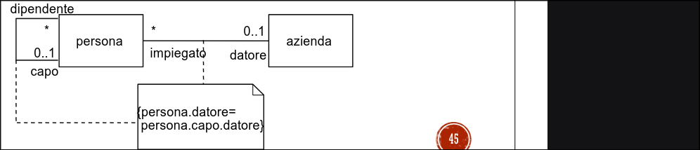
    Una persona o e' disoccupata o lavora al massimo per una azienda.
    Il post it dice che se una Persona e' capo di un altra allora queste due persone devono essere impiegati della stessa azienda.
    E' la stessa cosi come quando ti chiedevano di esprimere i vincoli inespressi nelle ER (infatti non useremo i post it ma frasi a fianco in linguaggio naturale).

* 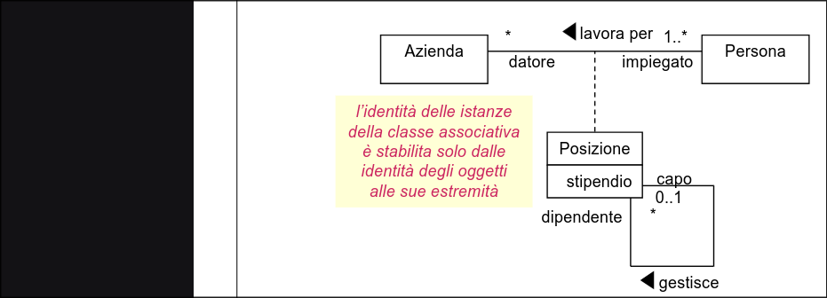
    Come nelle ER quando hai bisogno di mettere attributi nelle associazioni. Si creano classi associative: disegno una ulteriore classe con dentro gli attributi e poi collego con una linea tratteggiata all'associazione.
    La linea tratteggiata dice che esiste una associazione 1:1 tra le istanze della classe associativa e le istanze dell'associazione.
    E' una reificazione. Nelle ER ricorda che quando hai un istanza associazione tra due oggetti (anche se c'e' un'attributo nell'associazione) e vuoi ad esempio mantenere lo storico, devi reificare e aggiungere un attributo data (ad esempio) che fa da chiave (assieme a quelle esterne dei due oggetti).
    > [!WARNING]
    > In UML non esiste il vincolo di unicita' delle associazioni!
    > Quindi l'accoppiata degli stessi OID (in una associazione) puo' apparire piu' volte (nelle ER no obv).
    > PERO' NEL MOMENTO IN CUI METTI UNA CLASSE ASSOCIATIVA IN UNA ASSOCIAZIONE DIVENTA IDENTICA A QUELLE DELLE ER DOVE NON HAI REIFICATO!
    > Quindi non posso piu' avere piu' associazioni con gli stessi OID (anche se con date diverse (come ER)).

    Quindi se invece di Azienda avessi Uomo e al posto di Persona avessi Donna e volessi modellare piu' matrimoni tra le stesse persone non basta cambiare Posizione con Data perche' non posso avere piu' collegamenti tra le stesse persone (equivale all'er con un attributo sull'associazione).
    Quindi per modellare questa cosa devo proprio reificare Data e collegare Uomo e Donna tra di loro passando prima per data (equivale ad una reificazione (forte) nelle ER).
    
    > [!NOTE]
    > La classe associativa poi e' una classe vera e propria, infatti in questo esempio c'e' una associazione _organigramma_ tra Posizioni.
    > Modella il fatto che la gestione della Posizione e' locale al collegamento tra Azienda e Persona (?).

sono le 15:35, ancora 0 pause me so rotto er cazz.
Ora stiamo a p46 (23 del pdf)

COn quel diagramma a destra, stiamo dicendo che idSocio e' un campo che fa da chiave per i soci all'interno di un Club (assomiglia agli identificatori nelle ER).

Ora cominciamo le
### Associazioni N-arie

Associazione in cui ci sono piu' classi coinvolte. Non sono molto comuni.
Le associazioni sono ennuple (triple nelle ternarie) di OID.

#### 06/10/2026

Ora iniziamo le N-arie.
Coinvolgono 3 o piu classi. Corrispondono a triple (quadruple, ...) di OID.
Una ternarie e' falsa se ce' un ramo con molteplicita' 1 (potrei usare 2 binarie). Molteplicita' di 'andata' si intende, cioe' quelle che partono da una classe e vanno alle altre n-1.
Si assume che le ternarie siano sempre vere, quindi le molteplicita' sono sempre ad asterisco (quindi si omettono).
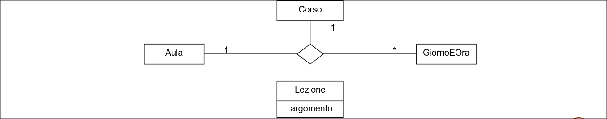
Quindi tutte le molteplicita' di andata sono *, infatti a un AUla corrispondono tanti corsi e GiorniEdOre.
Per capire se una ternaria e' una vera ternaria quindi devo guardare le molteplicita' di andata.
Quelle che sono disegnate li' allora sono molteplicita' di ritorno. Ad esempio perche' su GiornoEOra c' *?
Immagina di fissare un Aula e un Corso, si possono verificare in giorni diversi, quindi ci va *. Tipo IngSW in aula 3.4 c'e' sia il martedi' che il venerdi'.

In questo caso c'e' anche la classe associativa. Il vincolo che non si possono ripetere le triple non mi turba perhce' tanto data un aula, un corso e un orario ho solo una lezione.

## Elementi derivati

Un elemento derivato puo' essere calcolato a partire da un altro ma viene mostrato comunque per motivi di chiarezza.
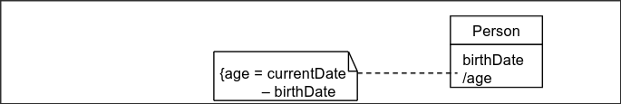
Devi fare calcoli simili a quelli per la ridondanza in ER.

Si puo' fare anche per le associazioni:
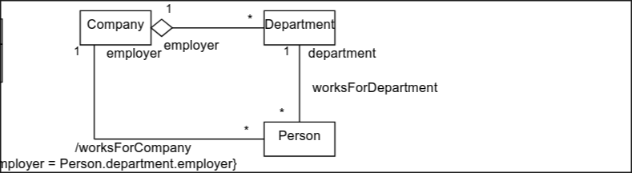
(Li c'era scritto Person.employer)
Invece di fare il giro lungo per vedere se una persona lavora in una azienda puoi vedere l'associazione ridondante cosi' risparmi di fare il giro lungo.

Attenzione quando crei un ciclo di solito hai creato una ridondanza. Significa che anche se la togli non perdi niente.

## Aggregazione

Rombo bianco - aggregazione debole, il composto non possiede le parti, il composto e le parti esistono lo stesso
Il tutto `NON` possiede le sue parti.

Vedi p49

E' diversa da:
## Composizione PART OF
Il tutto `POSSIEDE` le sue parti.
Nel rombo nero ci va sempre 1 sul rombo

(quel diagramma "finestra" ci sta che lo vedi ma non lo useremo)

### Se sono in un diagramma di progettazione dico anche delle cose al programmatore:

Quando hai il rombo bianco dici anche al programmatore di connettere le classi per delegazione con un riferimento.

Se invece ho il rombo bianco dentro la classe esterna devo avere classi interne.

## Generalizzazione

E' supportata anche l'ereditarieta' multipla.
Non capitera' spesso nelgi esercizi.

Nell'esempio di veicolo, camion e barca ci sono 2 gerarchie di veicolo.
Sono specificati infatti 2 diversi insiemi di generalizzazione, una gerarchia e' sulla propulsione e l'altra e' sul suo utilizzo.
Nelle parentesi graffe metti i vincoli, in questo caso ci va disjoint, overlapping, complete o incomplete.

## Classi Astratte

Definiscono comportamenti comuni alle sottoclassi:
Uso quindi ereditarieta' e polimorfismo con il late binding.
Estendibilta' e riusabilita': si adatta bene a cambiamenti futuri.

## Powertyping

Un'altra bella bega...

Nell'esempio di pag 55 dove metteresti l'attributo prezzo (dipende solo dall'articolo)? In articolo. 
Dove metteresti processore, 5G o 4G, impedenza? Nelle sottoclassi.
Invece se dovessi mettere un attributo sconto che dipende dal tipo di articolo? Eh eh, non posso metterlo nelle sottoclassi perche' poi pc diversi possono avere sconti diversi ma io ho detto che voglio uno sconto uguale per tutti i pc (dipende esclusivamente dal tipo di articolo).

# 09/10/2026

Torniamo al powertyping.
Potresti semplicemente creare una associazione tra Tipo e Articolo ma non sarebbe vincolato in nessum modo ai sotto tipi.
E' qui che entrano in gioco i Powertype
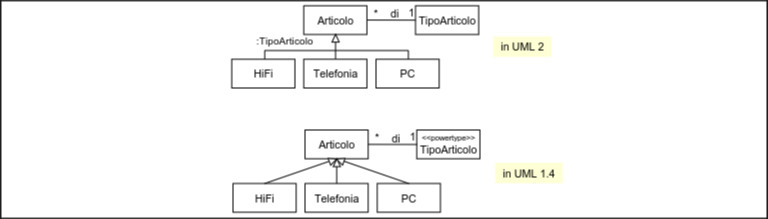
E' una `metaclasse`: le sue istanze sono altre classi.
Le istanze di TipoArticolo in questo caso sono HiFi Telefonia e PC.
E' paragonabile all'attributo static di java (in che modo?)

## Dipendenze

In generale, A dipende da B quando una variazione in B può comportare una variazione in A
NON LE USIAMO NEGLI ESERCIZI (nei quiz si suppongo).
parameters e uses (?)

## Template

NEANCHE QUESTO LO USEREMO (puo' comunque comparire nei quiz)
E' una classe parametrizzata

Nell'immagine
Si crea un template generale e in basso a destra ti fa vedere come si istanziano i parametri (in basso a sinistra c'e' una versione alternativa).
Che senso ha il template? serve per riusare una stessa classe 
Bind e' una `dipendenza` stereotipata.

## Raffinamento

Anche questo solo nei quiz.
Esprime una relazione tra due descrizioni dello stesso concetto a diversi livelli di astrazione:
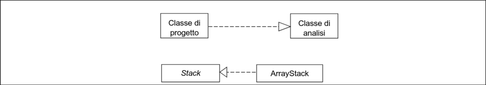
Due semantiche leggermente diverse: raffinamento e `realizzazione`

## Interfaccia

Il comportamento che la classe espone all'esterno, l'insieme delle operazioni pubbliche dell'oggetto.
E' rappresentata come una classe senza struttura, solo COMPORTAMENTO.
Non avendo struttura e' una classe ASTRATTA, quindi non istanziabile.
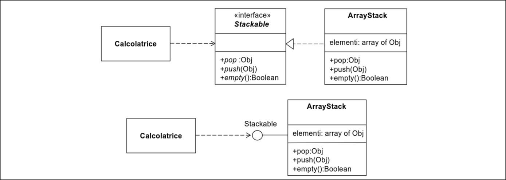
La freccia tra arrayStack e Stackable e una freccia di raffinamento di REALIZZAZIONE (non raffinamento e basta).
La classe Calcolatrice e' collegata a Stackable con una dipendenza. Infatti calcolatrice al suo interno usera' una classe Stackable.
L'interfaccia fa da separazione dalle classi che usano funzionalita' di altre classi (no aspe me so perso...)

Sotto c'e' la stessa cosa con una notazione molto piu' semplificata, ma sono la stessa cosa.

### INterfaccia VS ereditarieta'

La biblioteca presta libri e cd ma non riviste
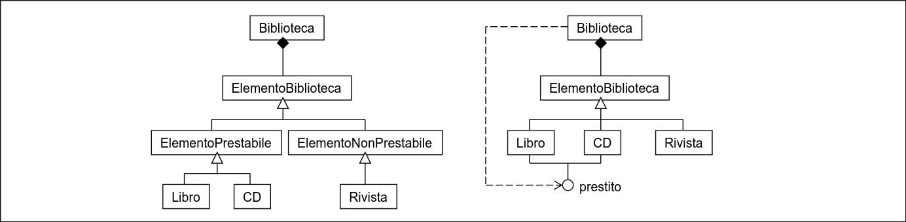

Quello di destra e' preferibile: Nella analisi ad oggetti non e' buona pratica avere gerarchie profonde.
L'altro motivo e' che essere prestabile e' una caratteristica di comportamento. Quella di destra ti fa vedere che alcune espongono l'interfaccia prestito e altre no.

# Diagrammi di ANALISI e di PROGETTAZIONE

Le classi di Analisi sono un po' piu' astratte, lvl un po' piu' alto, piu' vicino al dominio che al codice.
Noi disegneremo soprattutto diagrammi di Analisi (non solo).

## Come si disegna un diagramma di ANALISI?

Come nelle ER puoi sottolineare i nomi del testo e quelli _probabilmente_ sono classi.

* NON DEVI DISEGNARE SOLUZIONI IMPLEMENTATIVE.
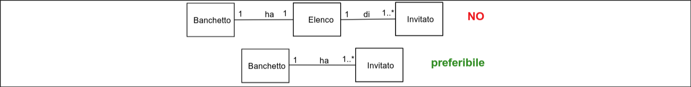

* Evita classi ridondanti, irrilevanti o vaghe.
Quando credi di fare classi vaghe prova ad instanziarle e vedere se ha senso.

* Evita classi onnipotenti che fanno un sacco di roba.

* Evitare di avere poche classi troppo complesse, ma anche tante classi troppo semplici

* Una classe è associata a un piccolo e ben definito insieme di responsabilità (normalmente tra 3 e 5)
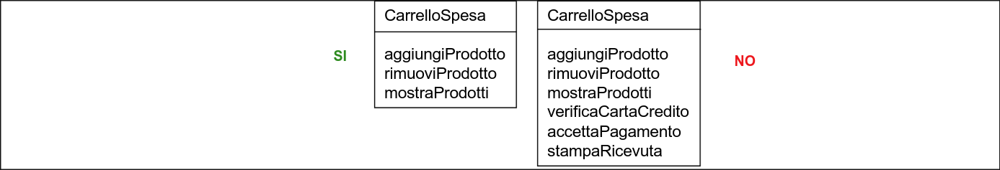

* Nessuna classe puo' essere isolata.

* Il nome deve essere espressivo, deve riflettere la natura intrinseca dell'oggetto e `non il ruolo` nell'associazione
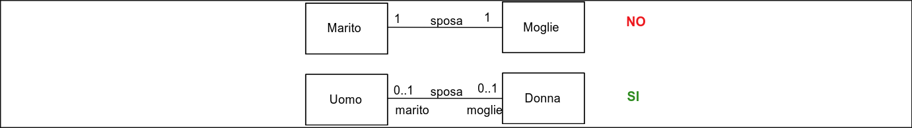

* Evitare le gerarchie di specializzazione profonde

* I nomi che descrivono oggetti dovrebbero essere espressi come attributi
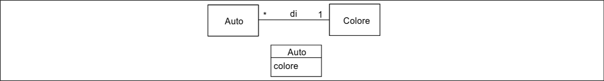
Dai devi fare gli stessi ragionamenti delle ER.

* Se una proprietà esiste indipendentemente, o compare più volte all’interno del diagramma, dovrebbe essere espressa come classe
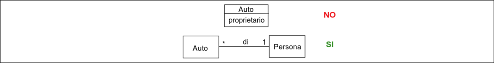
Vabbe' zioca ci arrivi...

Diobo non fa pause... abbiamo fatto pag 67 e 68... per ora sotto controllo ma non riesco a scrivere

Nel diagramma corretto dell'esempio p68 con la biblioteca, ci andrebbe un rombo tra biblioteca e libro.

* Evita le associazioni derivate... se proprio vuoi farlo le segni come derivate con lo `\`. 
    (stessa cosa con gli attributi (p70))

* Quando appropriato specifica i ruoli.

* non servono gli id (c'e' gia' l'OID gratis)

L'analisi procede per raffinamenti progressivi. Non arrivi la soluzione in una sola botta.

# Esercizio "si vuole automatizzare il sistema di gestione degli animali in uno zoo..."

Ricorda, e' simile alle ER ma non del tutto uguale... pensa alle classi che faresti in java...
Si, in poche parole devi fare anche la classe Zoo.

Rombo bianco tra Zoo e Animali... se chiude lo zoo gli animali rimangono indipendentemente dallo zoo.
Poi per il codice metto il `qualificatore` su genere.

Rombo nero tra Zoo e Area... se sparisce lo zoo anche le aree spariscono. Stessa identica cosa tra Area e Casa.
Poi collego Casa e Genere e ci scrivi "destinata a".
Poi ancora un'altra composizione Casa e Gabbia con rombo nero.

In ogni Gabbia ci sta un esemplare, ergo collego gabbia a esemplare ATTENZIONE PERO' si forma un ciclo: e' una associazione DERIVATA, metti lo \.
ACTUALLY non e' l'associazione tra gabbia e animale che rischia di essere derivata ma quella tra Animale e genere. 

# 13/10/2026

Finiamo l'esercizio dello zoo.
Ogni casa, ogni giorno, ha solo 1 addetto che la pulisce -> creo la classe Addetto, la collego con Casa e poi metto un attributo su Gabbia, GiornoDIPulizia.

Gli animali sono sottoposti periodicamente a controllo veterinario -> Creo la classe Veterinario, e faccio associazione Veterinario e Animale, poi potrebbe venirmi in mente di fare una classe associativa per memorizzare cose sul controllo, ma visto che lo stesso vet puo' visitare lo stesso animale mi serve reificarla: creo anche la classe COntrollo interposta tra Vet e Animale.

Ora facciamo diagramma dei casi d'uso:
Chi sono gli attori? (classi con comportamento attivo) Sono Veterinario, Animale e Addetto. Quindi faccio 3 omini con questi nomi sopra.
POi fai il rettangolone con scritto Zoo e dentro ci metterai i casi d'uso
Che casi d'uso ci sono? Visita (da collegare a Veterinario e Animale); Pulizia (da collegare a Addetto, e' un diagramma statico, non ci va gabbia).
    Poi vogliamo enfatizzare che si fa rilevazione peso e prescrizione dieta: faccio altri due casi d'uso che collego a Vet e Animale.
    POi visto che la rilevazione del peso e' fatta in una visita faccio una freccia (dipendenza) <<\include>> tra visita e Rilevazione peso (stessa cosa per Prescrizione dieta)

## Esercizio museo

Un museo si compone di diverse sezioni, ciascuna comprendente un certo numero di sale -> creo Museo, Sezione, Sala;
Ogni sezione ha un orario di visita ed e' custodita giornalmente da un solo custode, nel rispetto di un turno settimanale che resta invariato per tutto l'anno; il turno definisce per ciascun custode la sezione di cui si deve occupare in ciascun giorno della settimana -> Creo Custode che collego a Sezione, potrebbe venirmi in mente una classe associativa ma no buono, allora reifico e creo Turno interposto tra Custode e Sezione.
    Attenzione, anche la soluzione di reificare non va bene (perche?). Allora proviamo una associazione Ternaria.

ho dormito un po'

---

Ok esercizio finito. TOrniamo alla teoria.

## Diagramma di progettazione

Siamo a p74.
Identificae le classi di progettazione vuol dire identificare quelle classi che poi verranno effettivamente realizzate.

Identificare le associazioni di progettazione e' un po' piu' difficile. p76 Vediamo qualche esempio... (traduzione diagramma analisi a progettazione)
La soluzione in alto a sinistra e' completa? (puoi risolvere anche la query inversa? data una azienda puoi scoprire i suoi dipendenti?)
    In questo caso e' molto facile dire ogni persona per che azienda lavora ma per vedere chi lavora per una azienda devo vedere tutti i dipendenti di tutte le aziende e contare solo quelli appartenenti a una data azienda. Quindi la soluzione e' completa ma la query inversa e' molto piu' dispendiosa.
La soluzione di destra anche e' completa ed e' piu' adatta a fare la query che prima dicevamo che era inversa.

Sono due soluzioni perfettamente valide che sono adatte a due diversi carichi di lavoro.
Ma se il carico di lavoro e' bilanciato? Se chiedo sia la query diretta che inversa molto di frequente allo stesso modo?
Beh EASY faccio tutte e due le cose facendo una ridondanza (e' la soluzione in basso).
Il problema delle ridondanze e' soprattutto che rischi di avere inconsistenze. (non solo memoria in piu')
Ma grazie all'`incapsulamento` so che queste modifiche le faccio con dei metodi che toccano (solo loro) queste classi.

P.77
Le associazioni 1 a 1 possono essere collassate (mergiate) le due classi.
Per le associazioni ternarie invece devi per forza reificare e creare una quarta classe.
Anche in questo caso il modo di tradurre dipende dai volumi di carico di lavoro: in alcuni casi posso aggiungere riferimenti ridondanti per semplificare alcune operazioni.
Ad esempio se avessi una query "data un aula dire se c'e' una lezione" allora la soluzione a destra e' preferibile.

p78
Per le classi associative invece
La seconda soluzione suppone che ci sia anche un'altra query frequente: "che (quante) forniture ho per una data parte?". Se avessi aggiunto anche "e che fornitori?" avrei dovuto aggiungere anche un'altra ridondanza.

### Esercizio sui diagrammi di progettazione

Ti sara' dato il diagramma di analisi e un carico di lavoro e tu devi tradurre.
Step 1 copia tutte le classi.
Poi ci serve una classe contenitore (e' un ogetto che serve per raggiungere ttuti gli altri oggetti del dominio) che in questo caso non abbiamo: Aggiungiamo la classe Banca (che sara' istanziata da un solo oggetto).
Step 2: ordiniamo le query per ordine di frequenza e poi le analizziamo. La query A e' la piu' frequente. Calcolo saldo finale a partire...
Trova il punto di entrata della query e ottimizzalo solo se e' alta frequenza. Verifica che puoi raggiungere tutti gli oggetti a partire dal contenitore.
Collego banca a Estratto Conto con rombo bianco e poi ancora, Estratto Conto a Movimento sempre con rombo bianco (composizione?). Le cardinalita' le copi dal diagramma di analisi.
La prossima query e' la C: Il punto di entrata di questa query e' il Conto. Quindi collego Banca a Conto (sempre rombo bianco). POi da Conto collego a Cliente. Poi da CLiente (ripartendo da Banca) dvrei arrivare a Estratto Conto ma NON POSSO creare una associazione diretta tra i due perche' nel diagramma di analisi non c'era! Quindi Collego Cliente anche "all'indietro" a Conto. Quindi adesso avrei una ridondanza, la domanda e': Se i riferimenti in rosso non li creo (ridondanti?) (vedi foto), riesco comunque a rispondere alla query?

Se il diagramma di analisi avesse uno zero in "intestato a" (sopra) allora avrei dei clienti senza conto e quindi non potrei raggiungere alcuni clienti. Quindi avrei bisogno di altre associazioni tra Banca e Cliente.

### Esercizio progettazione Ditte

Il contenitore in questo caso non c'e', lo creo (non c'e' bisogno di mettere un nome). Ora copio le classi e ordino le query per frequenza.
La piu' frequente e' la A: "per una data Ditta stampa di tutti gli ordini coin stato "Evaso" includendo i dati angrafici dell'intestatario...
    La classe di entrata e' Ditta, da DIitta devo andare a Cliente (non posso andare direttamente a Ordine perche' non c'era nel diagramma di analisi). Da Cliente poi vai in Ordine (devi sempre usare rombi bianchi). Metto anche le molteplicita'. Poi da Ordine devo andare anche a Per e poi a Prodotto mettendo le cardinalita' che sono scritte nel diagramma di analisi.

B: "Stampa per ciascun prodotto..." Ora sta facendo le associazioni in rosso (sono possibilmente ridondanti) ma mi sa che le tiene.
Step finale verifica che puoi raggiungere tutti gli oggetti a partire dal contenitore.
I clienti li raggiungamo tutti perche' ogni cliente e' di una ditta e quindi si. Devi vedere se ci sono delle opzionalita'.
Ma se arrivi a Prodotto noti che non tutti i prodotti sono collegati a Per (Ordine) e quindi il collegamento in rosso che dicevamo prima mi serve e lo faccio diventare nero (gli altri rossi li toglie).

La meno frequente in genere non va ottimizzata. Con questa soluzione infatti la B e' eseguibile ma non e' immediata.

OK ultimi 5 minuti, vediamo il diagramma degli oggetti
## Diagramma degli oggetti

E' una istanza del diagramma delle classi. Non si usa di frequente, serve al programmatore per capire bene come istanziare.
A p79 vedi 3 esempi.
_:Poligono_ e' un modo per dire una qualsiasi classe di tipo poligono.

# 16/10/2026

Partiamo dal diagramma degli oggetti p80 e proviamo a ricostruire il diagramma delle classi che lo ha partorito (reverse engineering).

C'e' una classe club e una classe persona.
In Club (essendoci li tesoriere e presidente (che sono valori specifici di un qualificatore)) ci va qualificatore (metti un rettangolino attaccato a Club con scritto dentro Ruolo) Ruolo.
Come si traduce la parolina ufficiale e membro ? Mi dice che un ruolo e' un ufficiale?
Ho scritto l'esercizio nel eink.

## Diagramma dei package
p81

I package sono insiemi di cose che fanno operazioni simili.
Ci sono 3 tipi di relazioni tra package:
* boh
* lo stereotipo <<trace>> collegam un diagramma di progettazione a uno di analisi (?)
* p83: Il nucleo windows specializza il nucleo grafico. Le dipendenze non sono stereotipate quindi e' una dipendenza "use" -> il nucleo grafico usa quello windows.

Non li disegnamo ma possono essere nei quiz.

Spesso si usano nelle fasi iniziali dell'analisi per strutturare i componenti del software (senza irrigidirsi facendo un diagramma dei componenti che e' piu' formale).

Esercizio dell'autenticazione con spid e con ...
La seconda dal basso e' sbagliata perche' vuol dire che l'autenticazione chiama sia l'una che l'altra... no
La terza e' sbagliata (why?)
la quarta e' giusto ed e' una gerarchia "is a" (right?)

## Diagrammi di Interazione

si chiamano cosi' perche' mostrano la sequenza di interazione tra oggetti durante il funzionamento del sistema.
Le interazioni sono i messaggi che si mandano gli oggetti per realizzare un caso d'uso.

Ce ne sono di 4 tipi:
* Diagramma di sequenza: ordinato in ordine temporale
* Diagramma di inderazione: porta in primo piano "chi parla con chi";
* gli altri due diagrammi sono poco utilizzati

### Diagramma di Interazione di Sequenza

Puo' essere nel compito da disegnare (anche se a lui non piace e quindi non spesso).
Una interazione e'

Una `linea di vita` in pratica e' un oggetto (ma non proprio).

Si mostrano le interazioni tra linee di vita.
Quindi interazioni tra oggetti che si scambiano messaggi.

Le linee di vita si dispongono in alto nel diagramma e con la sintassi dei classificatori.
Non ho piu' voglia di fare screenshot (ma ti dico le pagine). E' a pagina 87.
In questo esempio ho una classe Conto. Nel secondo esempio ho una classe Persona e l'oggetto gianni che la istanzia...
Gli ultimi due esempi non li usiamo.

La linea tratteggiata rappresenta la linea di vita. Rappresenta che l'oggetto c'e', e' vivo, esiste... e interagira' con altri modi.

Ci sono diversi messaggi che si possono mandare gli oggetti:
* Di chiamata: un oggetto chiama una funzionalita' di un altro oggetto. Possono essere sincroni o asincroni;
    I sincroni si fanno con una freccia nera e dicono che quando chiamo aspetto la risposta e mi fermo nel frattempo (useremo soprattutto questi).
    Gli asincroni invece dicono che quando l'oggetto chiama una funzionalita' di un altro continua a fare 
* Di ritorno: lo manda l'oggetto di cui qualcuno ha chiamato una funzionalita' e serve per fare il return (dire che hai finito e restituire il risultato)
* Messaggi di creazione: si fanno con lo stereotipo create: si crea un istanza
* Messaggi di distruzione: si dice a un oggetto di distruggersi

Tutti questi elementi li combino in un diagramma di sequenza.
Ha due direzioni: nella verticale si ha il tempo, il susseguirsi di operazioni (piu' in alto e' prima). Nell'orizzontale(?)

#### Esempio p90
Ci sono 3 line di vita, la prima e' una istanza del classificatore utente che vedendo l'omino vediamo che e' un attore.
:Utente significa che e' un oggetto qualsiasi della classe utente.
Poi abbiamo una istanza di prestito
e infine la linea di vita di una istanza della classe libro (che ha come titolo "UML").

Il primo oggetto che si attiva e' utente (lo vedi dal rettangolo bianco).
L'utente per prima cosa invoca richiedi("UML") (chiama richiedi passandoci dentro UML (vuole quel libro)).
Manda un messaggio sincrono, quindi resta in attesa e quindi il rettangolo bianco rimane (e' attivo).
Quando l'oggetto richiesta prestito riceve la chiamata si attiva, inizia il rettangolo bianco. 
L'attivazione annidata che vedi poi significa che richiestaPrestito manda a se stesso un messaggio dicendo trova("UML").
L'oggetto poi viene trovato, trova("UML") ritorna. A questo punto richiestaPrestito manda un messaggio al Libro UML chiamando in Prestito.
Il libro allora crea un oggetto Prestito e iniziano i messaggi di ritorno a cascata.

Si possono anche non disegnare le attivazioni ma sono caldamente consigliate.

#### Esempio p92

Come implementare Undo Redo? Ogni tanto faccio una "foto" allo stato del mio programma e lo metto in uno stack (me ne serve uno per i Redo e uno per i Redo).
In questo diagramma di sequenza e' mostrato come fare cio' in un programma tipo per disegnare.

Appena faccio una modifica al disegno (supponiamo) lo SchemeDoc (il documento) si duplica e crea una copia del suo stato prima che faccio la modifica.
Poi il Doumento (SchemeDoc) chiama l'UndoRedoManager e gli dice di salvare la copia appena creata.
Cosa fa allora il Manager? Rimuove la lista dei Redo (si hai presenti che la perdi se fai una nuova modifica dai)

A un certo punto poi (piu' avanti nel tempo infatti il rettangolo e' interrotto) faccio un Undo.

#### Esempio p93

Il vincolo (indicato dalla freccia rossa) cosa esprime? Dice che quando cliente crea un Ordine e poi Paga poi l'ordine viene consegnato.
Il vincolo dice che tra il pagamento e la ricezione non devono passare piu' di 28 giorni.

I rettangoli arrotondati rappresentano degli stati. In questo caso l'oggetto della classe Ordine cambia stato nel tempo si vede.

===

#### Esempio p94
Mi sono perso 3 minuti...
il diagramma p 94 mostra dei frammenti combinati: il primo dice che se la condizione e' vera A manda un messaggio a B.
La seconda invece E' tipo uno switch dai si capisce (piu' che switch degli if a cascata).

#### Esempio p95
A p95 la classe Distributore ha 2 istanze.
L'interazione viene innescata dall'ordine (il pallino nero permette di non disegnare l'utente che manda il messaggio dispatch all'ordine).
Ho un ordine con tanti elementi quindi ho un loop, se l'elemento dell'ordine ha valore oltre 10K allora scelgo il distributore careful altrimenti l'altro.
Infine se serve una conferma allora si manda anche un messaggio.

Ora facciamo un esercizio su un diagramma di sequenza che faro' nell'eink

# 20/10/2026

10:50 Prima abbiamo fatto esercizi

## Diagramma degli STATI

E' il diagramma dinamico per eccellenza.
Stati in cui si trovano gli oggetti.

Lo `stato` di un oggetto e' l'astrazione dei valori dei suoi attributi (e dei suoi collegamenti (pensa marito e moglie, sono collegati (stato sposati))).
Gli stati cambiano con gli `eventi`. UML usa la Notazione di Harel
Gli eventi si assumono come istantanei (non interrompibili).

Lo stato si rappresenta con un rettangolo stondato, in alto ci va il nome dello stato.
Dento al rettangolo ci va tra le altre cose, una `attivita'` che e' la cosa che fa l'oggetto mentre si trova in quello stato.
Le transizioni tra stati si rappresentano con una freccia a cui devi associare un evento scrivendocelo sopra.
Le transizioni possono avere anche una condizione (Event Condition Action) -> quando accade l'evento, SE LA CONDIZIONE E' VERA, allora accade l'azione.
Sopra la freccia si scrivono cosi': `evento(parametri) [condizione] /azione`

L'azione si puo' riportare nello stato di arrivo (dopo entry)
Negli stati puoi anche scrivere l'evento scritto nello Stato invece che nella freccia.
Ci sono 

Il pallino nero serve solo a collegare piu' freccie insieme (in UML 1 non c'era neanche, non e' che mi sembri molto utile)
Il pallino grande e' il punto di ingresso.
Il pallino con il cerchio fuori significa l'attivita' che termina, cancelli tutto.

### TIpi di Eventi

* Eventi di Chiamata: lo hai quando all'oggetto arriva un messaggio. Un modo comunissimo per cambiare lo stato a un oggetto e' mandargli un messaggio. E' una operazione dell'oggetto
* Eventi temporali: when specifica il moemnto della transizione; after(10 seconds) significa "esci dallo stato dopo 10 secondi"

ora un paio di esercizietti oink

# 23/10/2026

Prima esercizietto adesso p102.
Stati compositi. 
Decomposizione OR = quando l'oggetto e' nel superstato l'oggetto e' in uno o nell'altro dei sottostati.
Li usiamo quando in un esercizio ti dice iuna cosa del tipo "in qualunque stato si trovi il macchininon del caffe, quando clicchi il tasto off si spegne", in questo caso posso raggruppare tutti gli stati che hanno lo stesso conporamento rispetto a un evento (ad esempio quella dell'esempio sopra).

Stato composito ortogonale (Decomposizione AND): quando l'oggetto si trova nel superstato puo' trovarsi contemporaneamente in piu' sottostati. Permetti di modellare specifiche di parallelismo.
Nell'esempio si vede che l'esame ha 3 stati, incompleto, superato, fallito.
Quelle 3 file dentro a Incompleto sono concorrenti (non ci sono vincoli di precedenza tra l'uno e l'altro) (non c'e' propedeuticita').

A p104 vedi che puoi usare una variabile di un altro sottoevento per delle condizioni in un altro sottoevento.

Ora facciamo un quiz su un diagramma (sempre negli esercizi di virtuale).
Ci ho anche fatto una foto, mi e' sembrato abbastanza semplice.

Ora torniamo sull'oink
